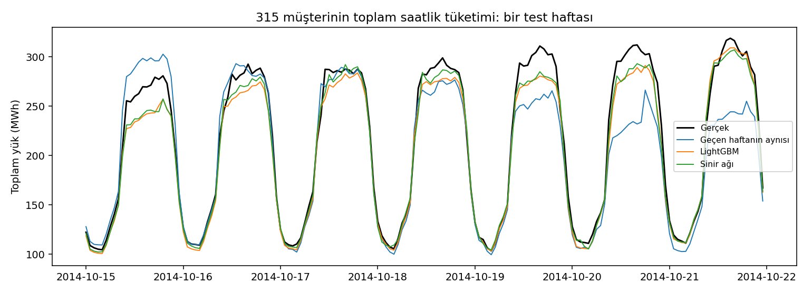
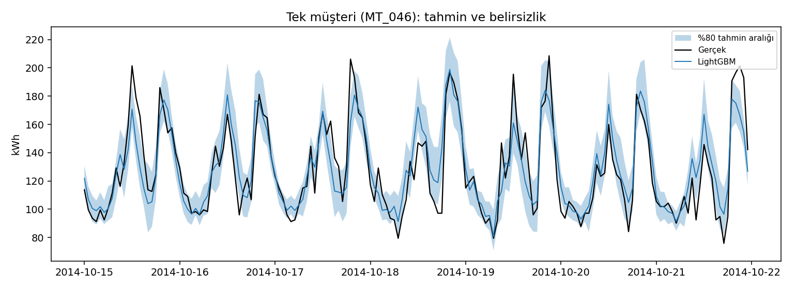
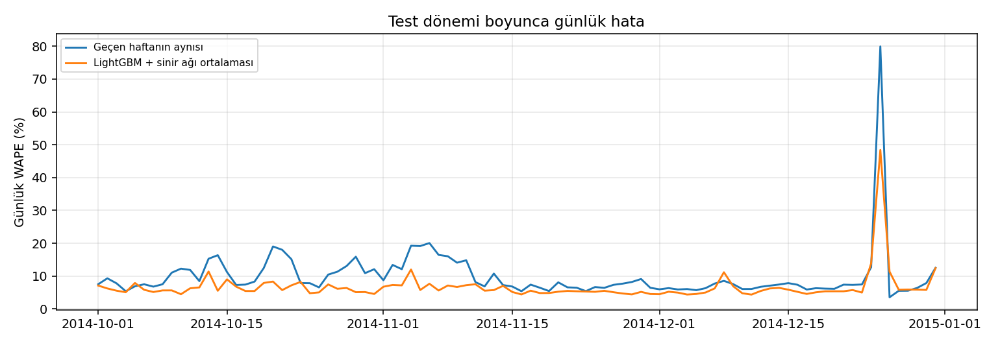

# Gün Öncesi Elektrik Talebi Tahmini

315 elektrik müşterisinin **ertesi günkü 24 saatlik tüketimini** tahmin eden bir sistem. Elektrik dağıtım ve tedarik
şirketleri gün öncesi piyasasında elektriği bir gün önceden satın alıyor; tahmin ne kadar iyiyse dengesizlik
maliyeti o kadar düşük.

- Basit yöntemler (dünün aynısı, geçen haftanın aynısı), **LightGBM** ve **sinir ağı** karşılaştırması
- Tüm müşteriler için tek bir global model: her müşteri kendi ortalamasına göre ölçekleniyor
- Tatil etkisi: Portekiz resmi tatilleri özellik olarak eklendi
- **Belirsizlik:** her saat için %80 tahmin aralığı (10. ve 90. yüzdelik)
- FastAPI servisi, testler, Dockerfile



## Veri

[UCI ElectricityLoadDiagrams20112014](https://archive.ics.uci.edu/dataset/321/electricityloaddiagrams20112014):
Portekiz'de 370 müşterinin 2011-2014 arası 15 dakikalık tüketimi. Saatlik kWh'e çevirip 2012-2014'ü kullandım;
2012 başında henüz bağlanmamış 55 müşteriyi çıkardım, 315 müşteri kaldı.

| Bölüm | Dönem | Gün |
| --- | --- | --- |
| Eğitim | 2012-01-08 → 2014-06-30 | 905 |
| Doğrulama (erken durdurma) | 2014-07-01 → 2014-09-30 | 92 |
| Test | 2014-10-01 → 2014-12-31 | 92 |

Her gün sonunda yalnızca o güne kadarki veriyle ertesi gün tahmin ediliyor; test boyunca 92 gün × 315 müşteri × 24 saat.

## Modeller

- **LightGBM:** her satır bir (müşteri, gün, saat). Özellikler: son 7 günün aynı saatindeki tüketim, dünün ortalama,
  en yüksek ve en düşük değeri, saat, haftanın günü, ay, müşteri büyüklüğü, hedef gün ve önceki gün tatil mi.
  6,8 milyon eğitim satırı, mutlak hata kaybı.
- **Sinir ağı:** son 7 günün 168 saatini ve takvim bilgisini alıp 24 saati birlikte tahmin eden 3 katmanlı ağ.
  Çıkış, dünün profiline eklenen bir düzeltme olarak öğreniliyor (kalıntı bağlantı).
- **Tahmin aralığı:** 10. ve 90. yüzdelik için ayrı LightGBM modelleri (quantile kaybı).

## Sonuçlar (test, Ekim-Aralık 2014)

| Model | Müşteri bazında WAPE | Medyan müşteri WAPE | Toplam yük MAPE | Eğitim |
| --- | --- | --- | --- | --- |
| Dünün aynısı | %8,52 | %8,44 | %4,52 | |
| Geçen haftanın aynısı | %9,65 | %8,82 | %5,89 | |
| LightGBM | %6,54 | %6,26 | %3,40 | 3 dk |
| Sinir ağı | %6,68 | %6,38 | **%3,19** | 19 sn |
| **LightGBM + sinir ağı ortalaması** | **%6,43** | **%6,14** | %3,23 | |

- **WAPE:** toplam mutlak hata / toplam tüketim. Medyan: müşterilerin kendi WAPE'lerinin ortancası
  (testte hiç tüketimi olmayan 1 müşteri hariç).
- **Toplam yük MAPE:** 315 müşterinin toplamı için saatlik yüzde hata; bir tedarikçinin piyasadan alacağı miktar bu.

En iyi basit yönteme göre hata müşteri bazında %25, toplam yükte %29 azaldı. İki modelin ortalaması ikisinden de
iyi; LightGBM ve sinir ağı farklı hatalar yapıyor.

**Tahmin aralığı:** %80'lik aralık gerçek değerlerin %77,6'sını kapsıyor (hedef %80); ortalama genişliği tüketimin
%18,8'i. Yani aralık hem dar hem de güvenilir.



### Tatiller

İlk denemede tatil bilgisi yoktu ve test döneminin en kötü günü **25 Aralık** oldu: o gün toplam tüketim normalin
%44 altına düşüyor ve 23 müşteri hiç elektrik kullanmıyor (işyerleri kapalı). Portekiz resmi tatillerini (hedef gün
ve önceki gün) özellik olarak ekleyince:

| | Tatil bilgisi yok | Tatil bilgisi var |
| --- | --- | --- |
| Müşteri WAPE | %6,54 | %6,43 |
| Toplam yük MAPE | %3,40 | %3,23 |
| 25 Aralık WAPE | %65 | %48 |
| 26 Aralık WAPE | %17 | %11 |

Noel hâlâ en zor gün: eğitimde sadece iki Noel var ve her müşteri tatile farklı tepki veriyor. Gerçek bir sistemde
tatil günleri için ayrı bir model ya da müşteri bazında geçmiş tatil davranışı kullanılmalı.



## API

```bash
uvicorn api.app:app      # http://127.0.0.1:8000/docs
```

| Uç nokta | Açıklama |
| --- | --- |
| `GET /musteriler` | Modelin tanıdığı müşteriler |
| `POST /tahmin` | Müşteri, hedef tarih ve son 7 günün 168 saatlik tüketimi → 24 saatlik tahmin ve %80 aralık |

```json
{"musteri": "MT_100", "hedef_tarih": "2014-10-21", "gunluk_toplam": 1409.26,
 "saatler": [{"saat": 0, "tahmin": 7.301, "alt": 7.269, "ust": 9.74}, "..."]}
```

Docker ile:

```bash
docker build -t enerji-tahmin .
docker run -p 8000:8000 enerji-tahmin
```

## Çalıştırma

```bash
python -m venv .venv
.venv\Scripts\activate          # Linux/macOS: source .venv/bin/activate
pip install -r requirements.txt
```

UCI sayfasından zip'i indirip içindeki `LD2011_2014.txt` dosyasını `data/indirme/` altına koyun.

```bash
python -m src.veri       # saatlik veriye çevirme
python -m src.egit       # modeller, test sonuçları, grafikler (~4 dakika)
pytest
```

## Klasör yapısı

```
src/
  veri.py          15 dakikalık veriden saatlik kWh, bölümler
  ozellikler.py    LightGBM özellikleri, sinir ağı girdisi, tatiller
  ag.py            gün öncesi sinir ağı
  egit.py          eğitim, karşılaştırma, aralık kapsaması, grafikler
  cikarim.py       tek müşteri tahmini (API için)
api/app.py         FastAPI servisi
tests/             API testleri
models/            LightGBM (orta, %10, %90), sinir ağı, müşteri ölçekleri
reports/           sonuçlar, günlük hatalar, grafikler
```

## Sınırlamalar

- Hava durumu (sıcaklık) yok; elektrik talebinde en önemli dış etkenlerden biri, eklenirse özellikle yaz ve kış
  aylarında hata düşer.
- Model sadece eğitimde gördüğü 315 müşteri için tahmin yapıyor; yeni bir müşteri için ölçek bilgisi gerekiyor.
- Aralıklar her saat için ayrı; günün toplamı için doğrudan bir aralık vermiyor.

## Yazar

Batın Dikilitaş, Kocaeli Üniversitesi Yapay Zeka ve Makine Öğrenmesi
